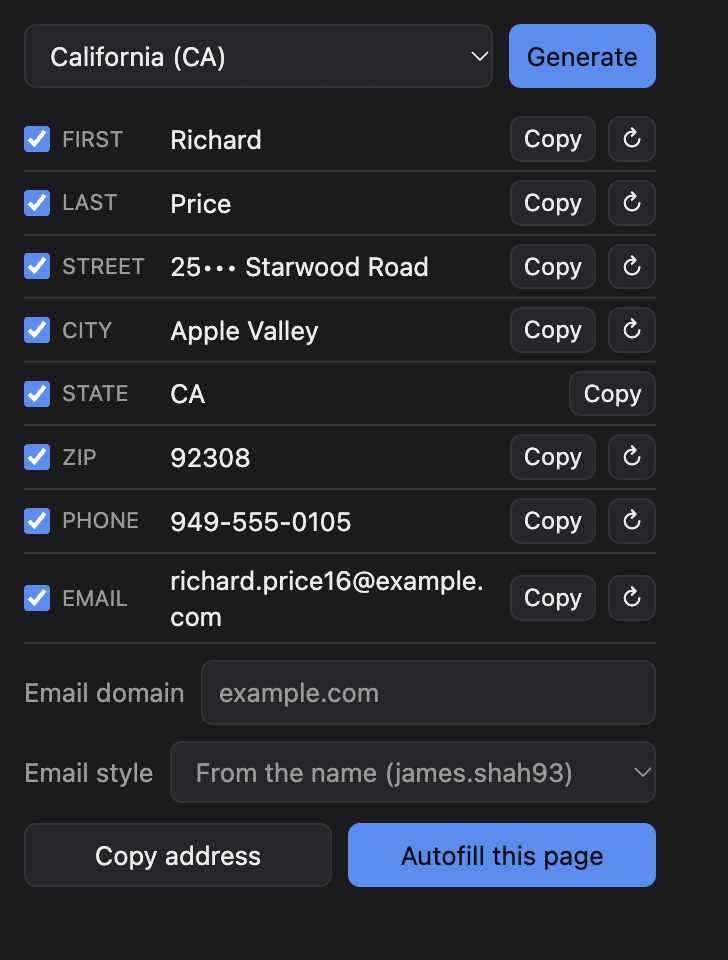

# Random Address: offline random US address, name, phone and email generator for Chrome and Brave

Random Address generates a random US address, name, phone number and email for the state you pick, and fills the signup form on the current page with one click. Out of the box it makes no network requests: no host permissions, no tracking, nothing leaves your browser. If you choose, it can also create a real alias with Firefox Relay or DuckDuckGo Email Protection. Only then does it contact that one service, and only when you press the button.

<p align="center">
  
</p>
<p align="center"><sub>The house number is masked in this screenshot. The extension shows the full address.</sub></p>

**In short:** pick a state, press Generate, press Autofill. You get a real street, city and ZIP from public address data, a name from census data, a phone number that can't ring anyone, and an email on a domain you choose. It works with Wi-Fi off, and you can check that it does.

## Why

Most signup sheets ask for a full name, street address and phone number when all they need is an email. Typing your real details into every one of them is how you end up on lists you never joined. Random Address gives you plausible, correctly formatted details in one click, so the form is satisfied and you've told it nothing about you.

It is built for people who distrust extensions, so the privacy claims are things you can check, not things you're asked to believe.

## What it generates

| Field | What you get | Where it comes from |
|---|---|---|
| Street, city, ZIP | A real address point in the state you pick | [USDOT National Address Database](https://www.transportation.gov/gis/national-address-database), about 1,000 points per state, bundled in the extension |
| First and last name | A common US name | SSA baby names (1970 to 2008) and US Census 2010 surnames. Never paired with a real person |
| Phone | A real area code for the state, then `555-0100` to `555-0199` | The 555-01XX block is reserved for fictional use, so the number can't ring anyone |
| Email | `james.shah93@yourdomain.com` or a random `k7qx2m9p4w@yourdomain.com` | Generated locally. The domain is yours to set |

Each field has a checkbox (include it in autofill or not), a copy button, and a re-roll button.

## Don't trust me, check me

Privacy tools earn trust by being easy to check. These take about a minute:

1. **Turn Wi-Fi off and press Generate.** It still works, because all the data is inside the extension.
2. **Look at the permissions.** Open `manifest.json`. The permissions are `activeTab`, `scripting` and `storage`. There is no `host_permissions`, no content script, no background page. The only optional host permissions are the two alias services, and the browser grants one only when you pick it and confirm its prompt. Check `chrome://extensions` > Random Address > Details > Site access to see whether you have.
3. **Watch the network tab.** Right-click the popup, choose Inspect, open the Network tab, and press Generate a few times. You should see no requests to any `http` or `https` host. With an alias service turned on, pressing **@** makes exactly one `POST` to that service and nothing else.
4. **Run the check.** `npm run check` fails if any shipped file contains `fetch`, `XMLHttpRequest`, `WebSocket`, `eval`, a dynamic `import()`, or a URL. There is one exception, matched character for character: `lib/addresses.js` imports the address file for the state you pick from the extension's own `data/addresses/` folder, so the popup loads one state instead of all of them. The other exception is `lib/alias.js`: one line that sends the request, and the two service URLs. The check also loads that module and confirms each service URL really points at `relay.firefox.com` or `quack.duckduckgo.com`, which catches a URL assembled from pieces. Any other use of `fetch`, any other URL, a changed CSP (the whole policy is pinned, not just `connect-src`) or another host in the manifest makes the check fail. It is a text check, so treat it as a tripwire. The CSP is the enforcement.
5. **Watch the check fail.** `npm test` includes tests that inject a `fetch` call, a host permission, a third alias host and a wider CSP into a copy of the project and assert that the check rejects each one.

What these prove, and what they don't: steps 1 and 3 show the extension works offline now, which is weak evidence by itself. The real guarantee is the combination of the CSP, the absence of network code outside `lib/alias.js`, and source you can read. The CSP allows the two alias services for everyone, because a CSP can't be switched per user. With no service turned on, the extension holds no permission to reach them and no code path calls them. Switching the service back to None gives the permission up. One gap applies to every extension of this kind: the autofill routine runs inside the web page, where the extension's CSP doesn't reach, so only the source check covers it. Chrome has no permission that hard-blocks network access, so no extension can promise that through a setting. This one promises it through code you can inspect.

### Claims and how to check them

| Claim | How to check it |
|---|---|
| It asks for no access to websites | `manifest.json` has no `host_permissions` or `content_scripts`. Its `optional_host_permissions` are only the two alias services, granted only if you pick one |
| Its pages can't send data anywhere else | The manifest CSP sets `default-src 'none'` and allows connections only to `relay.firefox.com` and `quack.duckduckgo.com`. The autofill routine runs inside the page, outside that CSP. The source check rejects the usual ways out (network calls, URLs, image beacons, navigation, loading elements, computed lookups), but it is a text check, not a sandbox |
| Its only network code is the alias button | `npm run check` |
| That check actually works | `tests/check-no-network.test.mjs` |
| It has no dependencies | `package.json` lists none. There is no build step and no minification |
| It only runs when you click | There is no background page or content script. Autofill is injected into the current tab when you press the button, through `activeTab` |
| It stores nothing but your settings | `chrome.storage.local` holds your state, email domain, email style, checkbox choices and, if you use one, your alias service and its key. `chrome.storage.session` holds the last alias you created and its site until you quit the browser. Nothing else |

## Install

Random Address isn't in the Chrome Web Store yet, so you install it from source as an unpacked extension. It works in Chrome and Brave (tested on Brave) and should work in other Chromium-based browsers, such as Edge. It is desktop only: Chrome for Android doesn't run extensions.

### 1. Get the files

- **With git:** `git clone https://github.com/launchstack-dev/browser-random-address.git`
- **Without git:** on the repository page choose **Code**, then **Download ZIP**, and unzip it. Browsers load folders, not zip files.
- **Just the shipped files:** run `npm run package` and unzip `dist/random-address-<version>.zip`. That folder has no tests or docs.

Put the folder somewhere permanent. The browser runs the extension from it, so moving or deleting it breaks the extension.

### 2. Load it

1. Open `brave://extensions` (or `chrome://extensions`, or `edge://extensions`).
2. Turn on **Developer mode** with the toggle in the top right.
3. Click **Load unpacked** and pick the folder that directly contains `manifest.json`. If you cloned the repository, that is the top-level folder, not `docs/` or `lib/`.
4. Pin it: click the puzzle-piece icon in the toolbar, then the pin next to Random Address.

### Firefox and Firefox for Android

The same folder works in Firefox 140 or later, and in Firefox for Android 142 or later. Until it is on addons.mozilla.org you load it for testing:

- **Firefox desktop:** open `about:debugging#/runtime/this-firefox`, click **Load Temporary Add-on**, and pick `manifest.json`. Firefox removes it when it restarts.
- **Firefox for Android**, from a computer over USB:
  1. On the phone: **Settings > About phone**, tap **Build number** seven times, then turn on **USB debugging** in **Developer options**. In Firefox, turn on **Settings > Remote debugging via USB**.
  2. On the computer: install Android's `adb` (`brew install android-platform-tools` on a Mac), plug the phone in, run `adb devices` and accept the prompt on the phone.
  3. Run `npm run android`. It uses Mozilla's `web-ext` tool to install the extension into Firefox on the phone and reloads it when files change. With more than one device attached, add `-- --android-device <id from adb devices>`.

On Android the popup opens as a full-screen panel from the Firefox menu (**⋮ > Extensions > Random Address**), and alias settings open in a tab.

### Update

Run `git pull` (or download the new version over the old folder), then click the reload arrow on the extension's card in `brave://extensions`.

### If something looks wrong

- **"Manifest file is missing or unreadable":** you picked the wrong folder. Pick the one that contains `manifest.json`.
- **No "Load unpacked" button:** Developer mode is off.
- **A "disable developer mode extensions" prompt at startup (Chrome):** you can dismiss it. The extension keeps working.
- **Anything else:** click **Errors** on the extension's card, or open an [issue](https://github.com/launchstack-dev/browser-random-address/issues).

## Use

1. Pick a state and press **Generate**.
2. Press **Autofill this page** to fill the form, or use the per-field **Copy** buttons.
3. Press **↻** next to a field to re-roll just that one. Street, city and ZIP re-roll together so the address stays real.
4. Untick any field's checkbox to keep autofill away from it.

Autofill matches fields by their `autocomplete` attribute first, then by name, id, placeholder and label. It fills empty fields only (plus fields it filled earlier), and it skips passwords, usernames, company names and card fields. It does not reach into shadow DOM.

### Creating aliases with Firefox Relay or DuckDuckGo

Press **Set up** next to **Aliases** in the popup. That opens the alias settings page, where you pick a service, allow it when the browser asks, and paste your key. Every permission prompt happens on that page, never in the popup. Firefox 140 and later also ask you to consent to the data the service receives: your key, and for Relay the site's hostname. An **@** button then appears on the Email row. Each press creates one new alias and puts it in the Email field. Generate and ↻ never contact the service, so re-rolling never uses up aliases. The alias stays in the Email field through Generate and name re-rolls, and is still there if the popup closes and you reopen it on the same site, so you don't spend a second alias by accident. Press ↻ on Email to drop it. Each service keeps its own key, so switching services never sends one service's key to the other. Switching to another service or to None gives up the old service's access.

- **Firefox Relay:** copy the API key from the Relay website's Settings page. The free plan has a small mask limit (5 by default), so create masks only for forms you mean to submit. Relay records the site's hostname with each mask so you can see where it was used.
- **DuckDuckGo:** free, with no alias limit that I could find, but DuckDuckGo doesn't show the key anywhere. Bitwarden's documented workaround: on duck.com's Email Protection page, open the **Autofill** tab, open your browser's developer tools on the **Network** tab, press **Generate Private Duck Address**, select the `addresses` request, and copy the value after `Bearer ` in its `authorization` header. DuckDuckGo doesn't document this API, so it may change without notice. DuckDuckGo isn't told which site the alias is for.

The key is stored as plain text in `chrome.storage.local` on your device. Anyone with that key can create aliases on your account, so treat it like a password. Requests are sent without your browser cookies, so being signed in to Relay or duck.com in the same browser doesn't matter.

### Using it with SimpleLogin, Proton Pass or your own catch-all

- **Catch-all domain:** set the email domain to one you own that has catch-all enabled (SimpleLogin custom domains, Proton, or your own mail server). Every address Random Address generates then becomes a working alias. Pick the **From the site** email style to get addresses like `amazon.k7qx2@yourdomain.com`, so when spam arrives you can see which site gave the address away. The random tail stops anyone guessing the address from the site name. **Random** works too if you'd rather the alias say nothing at all. Neither style hints at the name on the form.
- **Let your password manager do the email:** untick the Email checkbox. Random Address fills everything else, and Proton Pass or SimpleLogin's own autofill creates the alias.

## FAQ

### Is there a random address generator that works offline?
Yes, this one. All the addresses are bundled in the extension, so it needs no network connection and sends nothing anywhere. Only the optional alias button needs a connection.

### Are the addresses real?
The streets, cities and ZIP codes are real address points from the USDOT National Address Database, with unit numbers, landmarks and coordinates removed. They are places, not people: the data has no names attached. They are also real places where people may live, which is why the limits below matter.

### Can the fake phone number call a real person?
No. The last seven digits always fall in `555-0100` to `555-0199`, a block reserved for fictional use. The area code is a real one for the state so the number looks right to a form.

### Does it phone home?
No. Unless you turn on an alias service, it holds no host permissions and makes no requests. With one turned on, it contacts only that service, only when you press **@**. See [Don't trust me, check me](#dont-trust-me-check-me).

### Does it work with SimpleLogin or Proton Pass?
Yes, in two ways. See [Using it with SimpleLogin, Proton Pass or your own catch-all](#using-it-with-simplelogin-proton-pass-or-your-own-catch-all). It doesn't call either service's API. For API-created aliases, see [Creating aliases with Firefox Relay or DuckDuckGo](#creating-aliases-with-firefox-relay-or-duckduckgo).

### Which states are covered?
44 states plus DC. See [Coverage](#coverage).

### Is it on the Chrome Web Store?
Not yet. Install it from source for now.

### Does it work on my phone?
On Android, yes, in Firefox for Android. See [Firefox and Firefox for Android](#firefox-and-firefox-for-android). Chrome for Android and Safari on iPhone don't run this kind of extension.

## Limits and what it won't do

- It is for filling in signup sheets without handing out your real details. It is not for fraud, for getting past age or identity checks, for ordering deliveries to addresses that aren't yours, or for impersonating anyone.
- It will not generate Social Security numbers, card numbers, government ID numbers, real people's phone numbers, or non-US addresses.
- The addresses are real places. A site that verifies an address against a postal database will accept the street, but it may still reject a made-up unit or house number.
- It won't beat a form that checks your phone number or email by sending you a code.

## Coverage

44 states plus DC, about 1,000 address points each. HI, MI, MS, NV and NH have no usable rows in NAD release 24, and RI's rows have no city, so those six show as "no data" (disabled) in the dropdown. Adding them means sourcing addresses elsewhere. OpenStreetMap is an option, but its ODbL license adds share-alike obligations.

## Compared with the alternatives

Different kinds of tools solve this differently. The question that separates them for a privacy-minded user is what each one sends over the network.

| Kind of tool | Real addresses | Works offline | Needs access to sites |
|---|---|---|---|
| Web-based generator sites | Often | No | No, but your choices go to a server |
| Form-filler extensions with fake-data libraries | Rarely (made-up streets) | Usually | Often, on every site |
| Password-manager identities | You enter them | Depends | Through the manager |
| **Random Address** | Yes | Yes | Only on the tab you click, through `activeTab` |

That table is about categories, not products. Check any specific tool's permissions yourself.

## Provenance

Every field traces back to a source:

| Data | Source | Version | Terms |
|---|---|---|---|
| Street, city, ZIP | USDOT National Address Database, text file release 24 | Downloaded 2026-10-25 | Per DOT's [published disclaimer](docs/nad-terms.md), a federal work not subject to copyright (17 U.S.C. § 105) and "available for re-use without limitation or restriction". Provided as is, and not intended for mailing lists |
| First names | SSA baby names, top 1,000 per year and sex, 1970 to 2008, via the [hadley/data-baby-names](https://github.com/hadley/data-baby-names) mirror (ssa.gov blocks scripted downloads) | 2008 data, the mirror's last year | SSA data is a US government work. The mirror has no license file of its own |
| Surnames | [US Census 2010 surnames](https://www.census.gov/topics/population/genealogy/data/2010_surnames.html), top 1,000 | 2010 | US government work |
| Area codes | Real, in-service NANP area codes per state, written by hand | n/a | n/a |
| Phone tail, email | Generated locally | n/a | `555-0100` to `555-0199` is reserved for fiction |

What the build removes: unit, building, floor, room and landmark rows; rows with placeholder or junk streets or cities; rows with invalid ZIPs; `(city, ZIP)` pairs that appear fewer than three times; coordinates and every other NAD field. It then keeps a random sample per state. NAD is aggregated from many local sources, so a few mislabeled rows can survive.

NAD is not a mailing list and neither is this extension: please don't use the addresses for mailings. DOT's terms and what they leave open are summarized in [docs/nad-terms.md](docs/nad-terms.md).

## Building the data

Apart from the opt-in alias button, `scripts/build-data.mjs` is the only code that touches the network, and only on a developer machine. Its output in `data/` is committed, so using or installing the extension never runs it.

```sh
# Names: SSA baby names (GitHub mirror) and Census 2010 surnames
node scripts/build-data.mjs names

# Addresses: the NAD text file is an 8.5 GB zip that uses Deflate64, so you need 7-Zip
# (`brew install sevenzip`) and about 9 GB of free disk. Delete the zip afterwards.
curl -L -o nad.zip "https://data.transportation.gov/api/views/fc2s-wawr/files/596a301b-d548-4589-8c63-6b6a8dc34f30?filename=TXT.zip"
7zz e -so nad.zip TXT/NAD_r24.txt | node scripts/build-data.mjs addresses
```

## Development

There is no build step and no dependencies. Node runs the tests (developed on Node 26).

```sh
npm run ci      # no-network check plus all tests
npm run check   # just the no-network check
npm test        # just the tests
npm run package # build dist/random-address-<version>.zip for the Chrome Web Store
```

Store listing copy, permission justifications and screenshots are in [docs/store-listing.md](docs/store-listing.md). `scripts/make-icons.py` redraws the icons (needs Pillow, development only).

## Glossary

- **Catch-all domain:** a domain whose mail server accepts mail for any address, so every address you invent works.
- **CSP (Content Security Policy):** a rule in `manifest.json` that limits what the extension's pages can load or connect to. This one allows connections only to the two alias services.
- **NAD:** the National Address Database, the US Department of Transportation's collection of address points from state and local governments.
- **555-01XX:** the telephone numbers `555-0100` to `555-0199`, which are reserved for use in fiction and never assigned to real subscribers.
- **`activeTab`:** a Chrome permission that gives an extension access to the current tab only after you click it.

## License

The code is [MIT](LICENSE). The bundled data has its own terms: SSA and Census data are US government works, and NAD's published terms allow re-use without restriction but exclude mailing-list use (see [Provenance](#provenance)).
